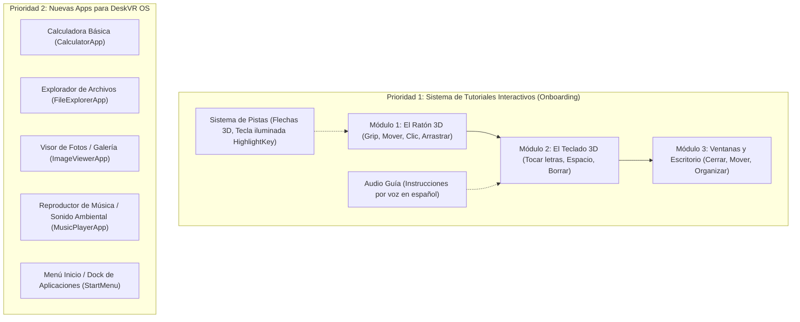

# 🤝 DeskVR: Documento de Transferencia Técnica y Guía de Arquitectura para la IA de Pablo

> **Para la IA de Pablo:**  
> Este documento ha sido generado por el equipo de **Carlos** para explicar en detalle la visión, arquitectura, metodología de trabajo, avances completados por Carlos y la hoja de ruta pendiente para **DeskVR**.  
> Léelo detenidamente antes de realizar modificaciones en el código o en la escena para mantener una coherencia técnica total.

---

## 📌 1. Visión y Propósito del Proyecto

**DeskVR** es una aplicación inmersiva de Realidad Virtual orientada a la **alfabetización digital e inclusión tecnológica**. Está diseñada para que personas con poca o nula experiencia en el uso de computadoras (adultos mayores, comunidades rurales, personas sin acceso previo a PCs) puedan aprender de manera segura, intuitiva y sin frustración los fundamentos de la informática:
- Cómo interactuar con un **ratón físico 3D** (movimiento relativo en alfombrilla, apuntado en pantalla y clics).
- Cómo escribir en un **teclado físico 3D** (distribución QWERTY, teclas de función, borrado, espaciado e intro).
- Cómo interactuar con una interfaz de **Sistema Operativo en Ventanas** (arrastrar ventanas, cerrar, cambiar foco, escribir en un editor de texto y abrir aplicaciones).

### Ficha Técnica
- **Motor:** Unity 6 (`6000.6.7f1`)
- **Pipeline:** Universal Render Pipeline (URP)
- **Framework VR:** OpenXR + XR Interaction Toolkit (XRI) `3.5.1`
- **Dispositivo Objetivo:** Meta Quest 2 (compatible con Air Link / Cable Link en PCVR y preparado para standalone Android).
- **Repositorio Oficial:** [GitHub - Carlos1058/DeskVR](https://github.com/Carlos1058/DeskVR.git)
- **Rama Principal:** `main`

---

## 🔄 2. Metodología de Trabajo y Buenas Prácticas

Para evitar conflictos de escena y desincronizaciones entre desarrolladores, seguimos una metodología estricta basada en:

### A. El Patrón "Builder Automatizado" (Single Source of Truth)
En lugar de depender exclusivamente de guardar la escena manualmente (lo cual genera conflictos de Git en archivos `.unity` de miles de líneas), disponemos de una herramienta en el Editor:
* **Script:** [`Assets/Editor/DeskVRWorkstationBuilder.cs`](file:///E:/Unity/Projects/DeskVR/Assets/Editor/DeskVRWorkstationBuilder.cs)
* **Menú en Unity:** `DeskVR > ⭐ 1. Cargar y Configurar Escena Limpia de DeskVR`
* **Función:** Este script crea y ensambla procedimentalmente toda la estación de trabajo: escritorio, iluminación, monitor Full HD, ratón y alfombrilla, teclado 3D con todas sus teclas y etiquetas, punteros en los mandos, sistema de ventanas, decoración (reloj, cuadros, plantas) y audio espacial.
* **Regla de oro:** Cualquier nuevo componente, prefab o aplicación del sistema debe estar contemplado o registrado en este Builder para que la escena pueda regenerarse limpia e idéntica en cualquier equipo.

### B. Ciclo de Desarrollo y Validación
1. **Modificación de Código C#:** Trabajar en los scripts bajo `Assets/_Project/Scripts/`.
2. **Validación de Compilación en CLI:** Ejecutar antes de cada commit:
   ```powershell
   dotnet build "E:\Unity\Projects\DeskVR\Assembly-CSharp.csproj"
   dotnet build "E:\Unity\Projects\DeskVR\Assembly-CSharp-Editor.csproj"
   ```
   *Debe compilar con 0 errores.*
3. **Prueba en Play Mode:** Probar en el Unity Editor con el visor Meta Quest 2 conectado.
4. **Guardado y Commit:** Guardar la escena `Assets/_Project/Scenes/DeskVR_Main.unity`, commitear con mensajes semánticos (`feat:`, `fix:`, `chore:`) y hacer `push` a `origin main`.

---

## 🛠️ 3. ¿Qué Ha Hecho Carlos? (Avances Completados)

Carlos ha diseñado, implementado y calibrado las capas fundamentales de la experiencia: el entorno espacial, la interacción física con periféricos, el teclado táctil de alta precisión y el sistema de ventanas.

### A. Entorno Espacial y Ergonomía VR
1. **Habitación y Estudio de Trabajo:**
   - Habitación con proporciones realistas, piso de madera cálida, paredes blancas, iluminación puntual empotrada en el techo y luz de lámpara de escritorio.
   - Escritorio de madera y alfombrilla oscura posicionados a alturas ergonómicas reales ($Y \approx 0.75\,\text{m}$).
   - **Ergonomía de Asiento Libre:** Se eliminó la silla virtual para permitir que el usuario se siente en cualquier silla real física sin colisiones visuales.
   - **Decoración e Inmersión:** Reloj de pared 3D decorativo, cuadros enmarcados, maceta con planta y sistema de sonido ambiental con zumbido suave y tictac periódico ([`DeskVRAmbientSoundManager.cs`](file:///E:/Unity/Projects/DeskVR/Assets/_Project/Scripts/OS/DeskVRAmbientSoundManager.cs)).

### B. Ratón Virtual 3D y Alfombrilla
- **Script:** [`VirtualMouseController.cs`](file:///E:/Unity/Projects/DeskVR/Assets/_Project/Scripts/Peripherals/VirtualMouseController.cs)
- **Agarre natural:** Se sostiene manteniendo presionado el botón **Grip** del mando derecho/izquierdo.
- **Restricción 2D:** El ratón físico en VR está restringido estrictamente a deslizarse sobre la alfombrilla ($Y$ fija), sin poder flotar en el aire.
- **Movimiento Relativo (*Delta Movement*):** El desplazamiento se calcula por deltas relativos de la mano. Si la mano se levanta o se desplaza en el aire, el ratón no sufre descalibraciones. Sensibilidad ajustada a $6500$ para cubrir un monitor de $1920 \times 1080$ con movimientos de muñeca cómodos.
- **Clic Izquierdo:** Se realiza con el gatillo (**Index Trigger**) del mando que sujeta el ratón, emitiendo un pulso háptico localizado y un sonido de clic.
- **Cursor en Pantalla ([`VirtualScreenCursor.cs`](file:///E:/Unity/Projects/DeskVR/Assets/_Project/Scripts/OS/VirtualScreenCursor.cs)):** Flecha clásica de OS renderizada en el Canvas del monitor, con soporte nativo de raycast para UI (hover, clics y arrastre).

### C. Teclado Virtual 3D: Touch-to-Type con Anti-Chatter y Anti-Rebote
Este es uno de los módulos más pulidos y avanzados del proyecto.
- **Scripts:** 
  - [`VirtualKeyboardController.cs`](file:///E:/Unity/Projects/DeskVR/Assets/_Project/Scripts/Peripherals/VirtualKeyboardController.cs)
  - [`VirtualKey.cs`](file:///E:/Unity/Projects/DeskVR/Assets/_Project/Scripts/Peripherals/VirtualKey.cs)
  - [`DeskVRPointerTip.cs`](file:///E:/Unity/Projects/DeskVR/Assets/_Project/Scripts/Peripherals/DeskVRPointerTip.cs)

#### Características del Teclado:
1. **Dimensiones y Accesibilidad:** Chasis un 30% más grande con teclas espaciadas y de escala amplia para facilitar el apuntado motriz.
2. **Orientación y Tipografía de Letras:**
   - Letras de tamaño gigante en **negro sólido** con fuente `Inter-Regular.ttf`.
   - Orientadas con rotación `Quaternion.Euler(90f, 0f, 0f)` para una lectura frontal perfecta desde la perspectiva del usuario sentado.
   - Se utiliza `UnityEngine.UI.Text` con `Overflow` y `Cull Off` (evitando los artefactos de saturación de distancia de TextMeshPro en sub-canvases pequeños que producían "cuadros negros").
3. **Puntualización Láser y Visualización:**
   - Cada mando cuenta con un puntero (`DeskVRPointerTip`) que emite un haz láser gradiente cónico hacia adelante.
   - Al posarse sobre cualquier tecla, el láser cambia de color a verde brillante (*active hover*), dando feedback visual inmediato del objetivo.
4. **Tecleo Directo (*Touch-to-Type*):**
   - **Se eliminó completamente la confirmación con el gatillo** (que causaba bloqueos de mano y confusión cognitiva). Ahora funciona como un teclado real: tocar la tecla la activa.
5. **Sistema Anti-Chatter & Histéresis de Doble Umbral (Schmitt Trigger):**
   - **Umbral de Activación:** $y \le 0.45$ (el puntero debe descender deliberadamente en la tecla para activarla).
   - **Umbral de Liberación:** $y \ge 0.65$ (el usuario debe levantar la mano ~2 mm por encima de la superficie de reposo para re-armar la tecla).
   - Esto crea una zona muerta física que neutraliza por completo los temblores fisiológicos de la mano en VR.
6. **Cerrojo por Tecla (*Per-Key Release Latch*):**
   - Mientras el usuario mantenga el dedo apoyado o hundido en la tecla, esta queda bloqueada tras emitir el carácter una sola vez. **Nunca se repite infinitamente**.
7. **Cooldowns de Debounce:**
   - **Misma tecla:** $250\,\text{ms}$ de delay para prevenir dobles toques accidentales por micro-rebote.
   - **Entre teclas distintas:** $80\,\text{ms}$ para permitir escritura fluida alternando manos.
8. **Feedback Multisensorial (*Juice*):**
   - **Mecánico:** Depresión física de $5\,\text{mm}$ al empujar, rebote confirmatorio de impacto (*confirm bounce*) y estiramiento elástico (*scale punch* del 6%).
   - **Visual:** Cambio de color a azul de activación con desvanecimiento progresivo.
   - **Háptico:** Impulso vibratorio en el mando que ejecuta el toque.
   - **Auditivo:** Clic acústico 3D con variación procedural de pitch ($\pm 8\%$).
9. **Inmunidad al Visor:** El sistema ignora la cámara del headset; solo las puntas de los mandos pueden interactuar con el teclado.

### D. Sistema Operativo DeskVR (Simulated OS)
- **Monitor Virtual:** Pantalla panorámica Full HD ($1920 \times 1080$) en World Space Canvas.
- **Gestión de Ventanas ([`VirtualWindow.cs`](file:///E:/Unity/Projects/DeskVR/Assets/_Project/Scripts/OS/VirtualWindow.cs)):**
  - Arrastre fluido haciendo clic en la barra de título superior.
  - Traer al frente (*bring to front*) al hacer clic en cualquier área de la ventana.
  - Botón de cierre $[X]$.
- **Editor de Texto / Bloc de Notas ([`TextEditorApp.cs`](file:///E:/Unity/Projects/DeskVR/Assets/_Project/Scripts/OS/TextEditorApp.cs)):**
  - Renderizado nítido con TextMeshPro (`TextMeshProUGUI`).
  - Escritura en tiempo real vinculada a los eventos del teclado 3D (`OnKeyTyped`).
  - Cursor parpadeante (`|`) y soporte para caracteres, espacio, enter y borrado (*Backspace*).
- **Guía Pedagógica Inicial ([`DeskVRPedagogicalGuide.cs`](file:///E:/Unity/Projects/DeskVR/Assets/_Project/Scripts/OS/DeskVRPedagogicalGuide.cs)):**
  - Panel informativo flotante en la escena para orientar los ejercicios DIX09 y DIX10.

---

## 📍 4. ¿En Qué Nos Quedamos? (Estado Actual Exacto)

* **Rama:** `main` al día con `origin/main` en `https://github.com/Carlos1058/DeskVR.git`.
* **Último Commit:** `a8840e4` (`chore(scene): save configured DeskVR_Main scene with latest keyboard and anti-chatter setup`).
* **Estado de la escena:** La escena `DeskVR_Main.unity` cuenta con el escritorio completo, periféricos 3D con lásers y feedback, Bloc de Notas abierto y listo para escribir, y el teclado totalmente calibrado.
* **Compilación:** 0 errores en compilación de scripts de juego y editor (`Assembly-CSharp.csproj` y `Assembly-CSharp-Editor.csproj`).

---

## 🎯 5. ¿Qué Falta por Hacer? (Hoja de Ruta para Pablo y su IA)

Esta es la sección principal en la que Pablo y su IA pueden concentrar sus esfuerzos. Los dos grandes pilares pendientes son: **Tutoriales Interactivos para el Usuario** y **Nuevas Aplicaciones del Sistema Operativo**.



### 🎓 Prioridad 1: Creación de Tutoriales Interactivos para el Usuario

El objetivo es construir un **sistema de tutoría guiada paso a paso** para personas que jamás han tocado una computadora. Se recomienda estructurarlo de forma modular (por ejemplo, con `ScriptableObjects` o una máquina de estados):

#### Módulo 1: "Conociendo y Dominando el Ratón"
1. **Paso 1.1 - Agarre:** El sistema le pide al usuario que tome el ratón físico sujetando el botón *Grip* del mando.
   - *Validación:* Comprobar que `VirtualMouseController.IsHeld == true`.
2. **Paso 1.2 - Deslizamiento:** Deslizar el ratón sobre la alfombrilla hasta llevar el cursor dentro de un círculo o diana en la pantalla.
   - *Pista visual:* Flecha 3D sobre la alfombrilla y diana parpadeante en pantalla.
3. **Paso 1.3 - El Clic Izquierdo:** Presionar el gatillo índice para hacer clic en un botón grande de prueba en pantalla.
   - *Validación:* Evento `OnClick` disparado.
4. **Paso 1.4 - Arrastrar una Ventana:** Hacer clic en la barra superior de una ventana y desplazarla a una zona indicada.

#### Módulo 2: "Escribiendo en el Teclado Virtual"
1. **Paso 2.1 - Reconocimiento de Teclas:** Resaltar una tecla en amarillo dorado mediante el método ya existente:
   ```csharp
   VirtualKeyboardController.Instance.HighlightKey("Espacio", true);
   ```
   El usuario debe tocarla una vez.
2. **Paso 2.2 - Escribir una Palabra:** Pedir al usuario que escriba una palabra sencilla (ej. "HOLA" o su nombre) en el Bloc de Notas.
   - Las teclas requeridas pueden iluminarse secuencialmente conforme las escribe.
3. **Paso 2.3 - Corregir con Borrar:** Indicar cómo usar la tecla `Borrar` (*Backspace*) para eliminar una letra errónea.
4. **Paso 2.4 - Salto de Línea:** Presionar `Intro` para bajar de renglón.

#### Módulo 3: "Gestión de Ventanas y Sistema Operativo"
1. **Paso 3.1:** Minimizar y cerrar una ventana usando el botón $[X]$.
2. **Paso 3.2:** Abrir una aplicación desde un icono en el escritorio (o desde el Menú Inicio).
3. **Paso 3.3:** Alternar entre dos ventanas abiertas haciendo clic en cualquiera de ellas para traerla al frente.

#### Componentes Clave a Implementar para los Tutoriales:
- **`TutorialManager.cs` / `LessonManager.cs`:** Controlador del flujo de lecciones, progreso y condiciones de éxito.
- **Pistas Sensoriales (*Visual & Audio Hints*):** 
  - Marcadores visuales en 3D (flechas que señalan el ratón o el teclado).
  - Resaltado de teclas (`key.SetHighlight(true)` ya está implementado en `VirtualKey.cs`).
  - Textos de instrucción claros con tamaño generoso en español.
  - Opcional: clips de audio con voz amable y pausada para cada paso.
- **Registro de Métricas Pedagógicas (`MetricsCollector.cs`):** Medir el tiempo empleado en cada tarea, conteo de errores y aciertos para evaluación académica/docente.

---

### 💻 Prioridad 2: Nuevas Aplicaciones para DeskVR OS

Para transformar la experiencia en un sistema operativo completo y entretenido, faltan las siguientes aplicaciones (todas diseñadas como ventanas flotantes hijas del Canvas del monitor):

#### 1. Calculadora Básica ([`CalculatorApp.cs`])
- **Propósito:** Practicar el teclado numérico y la precisión con el ratón.
- **Componentes:**
  - Pantalla superior con números grandes y claros.
  - Botones del 0 al 9, operaciones básicas (`+`, `-`, `*`, `/`), igual (`=`) y limpiar (`C`).
  - Capacidad de interactuar **tanto haciendo clic con el ratón** en los botones de pantalla, **como tocando los números en el teclado 3D**.

#### 2. Explorador de Archivos / Mis Documentos ([`FileExplorerApp.cs`])
- **Propósito:** Enseñar el concepto de carpetas y archivos.
- **Componentes:**
  - Barra lateral con accesos rápidos: *Documentos*, *Imágenes*, *Papelera*.
  - Vista de cuadrícula con iconos de carpetas y archivos de texto (.txt).
  - Doble clic o clic simple para abrir archivos en el Bloc de Notas.

#### 3. Visor de Imágenes ([`ImageViewerApp.cs`])
- **Propósito:** Demostrar cómo una computadora muestra fotografías.
- **Componentes:**
  - Ventana con una imagen de muestra (paisaje, animal, foto familiar).
  - Botones de "Anterior", "Siguiente" y "Zoom".

#### 4. Menú Inicio / Barra de Tareas Mejorada ([`DesktopTaskbar.cs`])
- **Propósito:** Un punto central para abrir y alternar aplicaciones.
- **Componentes:**
  - Botón `🖥️ DeskVR` en la esquina inferior izquierda que despliega un menú con la lista de aplicaciones instaladas (Bloc de Notas, Calculadora, Tutoriales, Ajustes).
  - Reloj digital en la esquina inferior derecha con la hora del sistema en tiempo real.

#### 5. Panel de Ajustes / Configuración ([`SettingsApp.cs`])
- **Propósito:** Personalizar la experiencia VR.
- **Componentes:**
  - Sliders para: Sensibilidad del ratón, volumen de los efectos de sonido y altura del escritorio.

---

## ⚠️ 6. Reglas de Oro y Advertencias Técnicas (Importante para la IA de Pablo)

1. **NO volver a activar el gatillo obligatorio para teclear:**
   - La pulsación táctil directa (*touch-to-type*) combinada con el cerrojo por tecla (*latching*) y la histéresis de doble umbral es la solución óptima y validada en VR. No añadas `WasTriggerPressedThisFrame()` para escribir letras.
2. **NO cambiar la rotación de los Canvases de las teclas:**
   - Las teclas usan `Quaternion.Euler(90f, 0f, 0f)`. Si se pone en `-90f` o `0f`, las letras se verán de cabeza o desaparecerán.
3. **NO usar TextMeshPro en los Canvases individuales de las teclas:**
   - En Unity URP, colocar `TextMeshProUGUI` dentro de mini-canvases con escalas no uniformes produce artefactos de SDF que saturan el render en cuadros negros opacos. Para las teclas se debe usar `UnityEngine.UI.Text` con `Overflow` y fuente TTF (`Inter-Regular.ttf`).
   - Para ventanas, menús y el Bloc de Notas, `TextMeshPro` sí funciona de maravilla y debe seguir usándose.
4. **Cualquier cambio a la estación debe actualizar `DeskVRWorkstationBuilder.cs`:**
   - Si creas un nuevo prefab o app, agrégala al método correspondiente dentro de `DeskVRWorkstationBuilder.cs` para que al pulsar `DeskVR > ⭐ 1. Cargar y Configurar Escena Limpia de DeskVR` todo se configure automáticamente.
5. **Todas las nuevas ventanas deben heredar o integrarse con `VirtualWindow.cs`:**
   - Esto asegura que soporten automáticamente arrastre de barra superior, botón de cerrar y sistema de foco (*bring to front*).

---

## 🚀 7. Guía Rápida para Arrancar

```powershell
# 1. Asegúrate de tener la última versión de main
git pull origin main

# 2. Abre Unity 6 (6000.6.7f1) con el proyecto DeskVR
# 3. En la barra superior de Unity, presiona:
#    DeskVR > ⭐ 1. Cargar y Configurar Escena Limpia de DeskVR

# 4. Verifica que los scripts compilen sin errores:
dotnet build Assembly-CSharp.csproj

# 5. ¡Listo para programar los tutoriales y las nuevas apps!
```

---
*Documento preparado con éxito para la sincronización y colaboración entre los equipos de desarrollo e Inteligencias Artificiales de DeskVR.*
