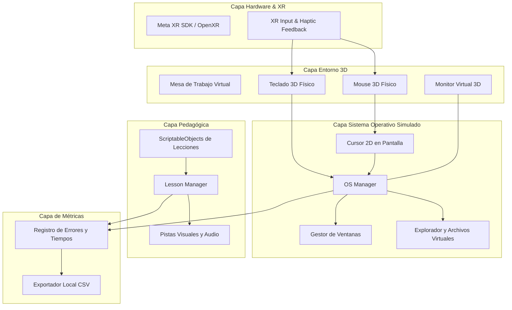

# DeskVR 🖥️🥽

> **Entorno de Realidad Virtual para el aprendizaje intuitivo del uso básico de una computadora.**

[-blue.svg)](https://www.meta.com/quest/)
[-black.svg)](https://unity.com/)

---

## 📖 Descripción del Proyecto

**DeskVR** es una aplicación de Realidad Virtual diseñada específicamente para personas con **baja alfabetización digital**. 

A diferencia de las aplicaciones tradicionales de VR, el propósito de DeskVR **no es enseñar a usar la realidad virtual**, sino utilizar la inmersión 3D como un **simulador y puente de entrenamiento seguro** para que el usuario aprenda a interactuar con una computadora física real y su interfaz gráfica desde cero.

### 🌟 Propuesta de Valor y Principios de Diseño
* **Aprendizaje desde Cero:** No se presupone ningún conocimiento previo (conceptos como *cursor*, *clic*, *ventana* o *archivo* se explican y demuestran paso a paso).
* **Entorno Libre de Frustración:** Un espacio de práctica seguro donde el usuario puede cometer errores sin temor a desconfigurar un equipo físico o perder datos reales.
* **Interacción Directa con Hápticos:** Aprendizaje kinestésico mediante acciones físicas (mover el mouse sobre la mesa, sentir la vibración al hacer clic, presionar teclas virtuales).
* **Progresión Modular Guiada:** Actividades cortas con retroalimentación inmediata (visual, auditiva y háptica) antes de combinar tareas más complejas.

---

## 🛠️ Stack Tecnológico

| Área | Tecnología |
| :--- | :--- |
| **Motor Gráfico** | Unity (2022.3 LTS / Unity 6 LTS) |
| **Pipeline de Renderizado** | Universal Render Pipeline (URP) |
| **Dispositivo Objetivo** | Meta Quest Standalone (Quest 2, Quest 3, Quest 3S) |
| **SDK / Framework XR** | OpenXR & Meta XR Core SDK / XR Interaction Toolkit (XRI) |
| **Lenguaje de Programación**| C# (.NET Standard) |
| **Interfaz Simulada** | Unity World-Space Canvas / Render Textures |
| **Animación y UX** | DOTween / LeanTween |
| **Métricas y Analíticas** | Persistencia local en visor (CSV / JSON exportable) |

---

## 🏛️ Arquitectura del Sistema

DeskVR está estructurado en una arquitectura desacoplada por capas:

Para más detalles sobre la arquitectura de software, consulta la [Guía de Implementación](docs/implementation_plan.md).

---

## 🎯 Estructura del Aprendizaje (Módulos)

1. **Módulo 1: Manejo Básico del Mouse**
   * Agarre y postura del mouse sobre la mesa.
   * Mapeo de movimiento físico al cursor en pantalla.
   * Clic izquierdo (selección simple).
   * Doble clic (apertura de programas/carpetas).
   * Clic derecho (menús contextuales).
   * Arrastrar y soltar (*drag & drop*).

2. **Módulo 2: Introducción a la Interfaz y Ventanas**
   * Identificación de elementos (Escritorio, Barra de tareas, Iconos).
   * Manejo de ventanas: abrir, minimizar, maximizar, mover y cerrar.

3. **Módulo 3: Introducción al Teclado y Escritura**
   * Reconocimiento de teclas alfanuméricas.
   * Teclas de control (Enter, Espacio, Retroceso/Borrar).
   * Escritura básica en el Bloc de Notas simulado.

4. **Módulo 4: Archivos y Carpetas**
   * Creación de nuevas carpetas.
   * Renombrado de archivos.
   * Guardado de documentos y organización básica.

5. **Módulo 5: Evaluación y Retos Integradores**
   * Tareas compuestas sin asistencia directa para medir el nivel de autonomía alcanzado.

---

## 📊 Métricas de Evaluación Académica

Para validar la efectividad de la herramienta en sesiones de prueba con usuarios reales, el sistema recopila automáticamente en formato `.csv`:
* **Tiempo por tarea / lección.**
* **Cantidad y tipo de errores** (clics fuera de zona, selecciones incorrectas).
* **Frecuencia de pistas o ayudas solicitadas.**
* **Tasa de éxito y nivel de autonomía** alcanzado por sujeto.

---

## 👥 Equipo de Desarrollo

* **Carlos Abraham Negrete de la Cruz**
* **Juan Pablo Hernández Gómez**
* **Luis Ángel Soto Alderete**
* **Miguel Ángel Vázquez Ornelas**
* **Ángel Cruz Mora**

### 🎓 Contexto Académico
* **Materia:** Teoría de Sistemas Interactivos
* **Profesor:** Luis Roberto Ramos Aguiar
* **Año:** 2026

---

## 📄 Licencia

Este proyecto está desarrollado con fines académicos y de investigación en accesibilidad e interacción humano-computadora.
