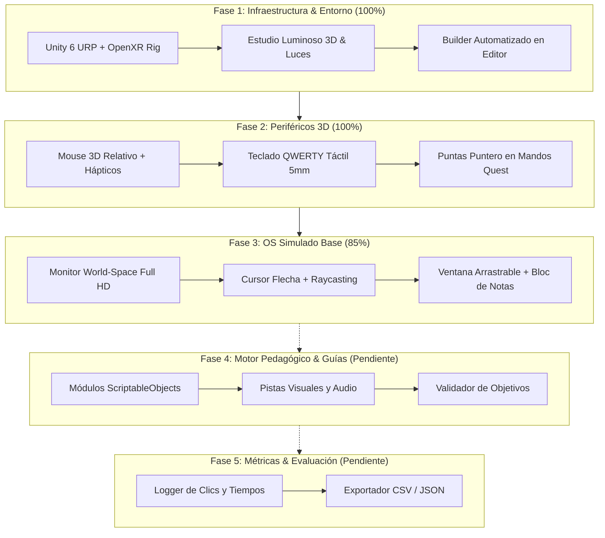

# 📊 DeskVR: Estado Actual del Proyecto y Reporte de Avances

**Proyecto:** DeskVR 🖥️🥽  
**Objetivo:** Simulación de Realidad Virtual para la enseñanza intuitiva del uso de la computadora (mouse, teclado, ventanas y archivos) a personas con baja alfabetización digital.  
**Plataforma / Hardware:** Meta Quest 2 (Air Link PCVR / Standalone Android).  
**Entorno de Desarrollo:** Unity 6 (`6000.6.7f1`) + URP + OpenXR + XR Interaction Toolkit (XRI).  
**Repositorio:** [GitHub - Carlos1058/DeskVR](https://github.com/Carlos1058/DeskVR.git)  
**Fecha de actualización:** Noviembre 2026.

---

## 🏗️ 1. Resumen Ejecutivo

DeskVR ha superado con éxito las fases iniciales de infraestructura técnica, diseño de entorno espacial 3D, desarrollo de periféricos físicos interactivos y la base del sistema operativo simulado. 

Actualmente, el usuario puede sentarse en su silla real, colocarse el visor Meta Quest 2, interactuar físicamente con un **ratón 3D** en su alfombrilla (movimiento por desplazamiento relativo y clics con gatillo) y escribir en un **teclado 3D QWERTY** (con pulsación física de teclas de 5 mm, feedback háptico, visual y sonoro), visualizando el cursor y el texto en tiempo real dentro de una ventana arrastrable de **Bloc de Notas** en un monitor virtual.



---

## ✅ 2. ¿Qué Está Funcionando? (Avances Completados)

### A. Entorno Espacial y Ergonomía VR
* **Habitación de Estudio Nórdica:** Piso de roble cálido, alfombra bajo el escritorio, paredes en blanco roto, rodapiés, ventana grande con vista al exterior y repisa con libros.
* **Sistema de Iluminación Confortable:** 4 focos empotrados en el techo con luces puntuales de alta intensidad, lámpara de escritorio cálida, luz solar direccional y luz ambiental enriquecida.
* **Ergonomía de Asiento Libre:** Se eliminó deliberadamente la silla virtual para evitar colisiones visuales con la silla física del usuario; el usuario puede sentarse en cualquier silla real y calibrar su posición de forma natural.
* **Escena Dedicada:** Escena propia [`Assets/_Project/Scenes/DeskVR_Main.unity`](file:///E:/Unity/Projects/DeskVR/Assets/_Project/Scenes/DeskVR_Main.unity) completamente desacoplada de las plantillas de muestra.

### B. Periféricos Físicos 3D Interactivos
* **Mouse Virtual 3D ([`VirtualMouseController.cs`](file:///E:/Unity/Projects/DeskVR/Assets/_Project/Scripts/Peripherals/VirtualMouseController.cs)):**
  * Sujeción natural con el botón *Grip* del mando.
  * Restricción estricta al plano de la alfombrilla ($Y$ fija con orientación frontal).
  * Movimiento basado en desplazamiento relativo (*delta*): no se descalibra ni se traba en los bordes.
  * Sensibilidad optimizada ($6500$) que permite cubrir todo el monitor con movimientos cómodos de mano.
  * Clic izquierdo con el gatillo (*Trigger*) del mando con pulso háptico diferenciado.
* **Teclado Virtual 3D ([`VirtualKeyboardController.cs`](file:///E:/Unity/Projects/DeskVR/Assets/_Project/Scripts/Peripherals/VirtualKeyboardController.cs) y [`VirtualKey.cs`](file:///E:/Unity/Projects/DeskVR/Assets/_Project/Scripts/Peripherals/VirtualKey.cs)):**
  * Distribución QWERTY procedimental completa sobre chasis biselado.
  * Sistema de pulsación física: cada tecla se hunde **5 mm** al contacto.
  * Puntas táctiles en los mandos (`DeskVR_PointerTip`) con esferas visibles para facilitar la puntería en 3D.
  * Cuádruple retroalimentación por tecla:
    1. **Mecánica:** Desplazamiento y retorno elástico.
    2. **Visual:** Cambio de color a azul de activación.
    3. **Háptica:** Vibración en el mando que presiona la tecla.
    4. **Auditiva:** Sonido espacial de clic mecánico.
  * Detección de teclas especiales: Barra espaciadora, *Enter*, *Backspace* y alfanuméricas.

### C. Sistema Operativo Simulado y UI
* **Monitor Virtual:** Pantalla Full HD ($1920 \times 1080$) en World Space Canvas.
* **Cursor de Pantalla ([`VirtualScreenCursor.cs`](file:///E:/Unity/Projects/DeskVR/Assets/_Project/Scripts/OS/VirtualScreenCursor.cs)):**
  * Gráfico nítido de flecha blanca clásica de sistema operativo.
  * Raycasting directo mediante la cámara VR vinculada (`worldCamera`), resolviendo problemas de pérdida de foco.
  * Soporte de eventos nativos: *PointerEnter* (hover), *PointerDown*, *PointerUp*, *PointerClick* y *Drag*.
* **Gestor de Ventanas ([`VirtualWindow.cs`](file:///E:/Unity/Projects/DeskVR/Assets/_Project/Scripts/OS/VirtualWindow.cs)):**
  * Arrastre fluido de ventanas haciendo clic en la barra de título superior.
  * Traer al frente (*bring to front*) al hacer clic en cualquier área de la ventana.
  * Botón de cierre $[X]$.
* **Aplicación Bloc de Notas ([`TextEditorApp.cs`](file:///E:/Unity/Projects/DeskVR/Assets/_Project/Scripts/OS/TextEditorApp.cs)):**
  * Escritura en tiempo real vinculada a los eventos del teclado 3D.
  * Cursor de inserción parpadeante (`|`) y texto de ayuda cuando está vacío.
  * Acceso directo mediante icono en el escritorio.

### D. Herramientas de Desarrollo y Flujo de Trabajo
* **Script de Automatización ([`DeskVRWorkstationBuilder.cs`](file:///E:/Unity/Projects/DeskVR/Assets/Editor/DeskVRWorkstationBuilder.cs)):**
  * Menú en Unity: `DeskVR > ⭐ 1. Cargar y Configurar Escena Limpia de DeskVR` y `DeskVR > 2. Reconstruir Estación y Estudio en Escena Actual`.
  * Soporte de ejecución en segundo plano (*Batchmode* sin interfaz gráfica).
* **Control de Versiones:** Repositorio en GitHub sincronizado y al día en la rama `main`.

---

## ⏳ 3. ¿Qué Falta por Desarrollar? (Próximos Pasos)

A continuación se detalla lo pendiente para completar el alcance pedagógico y académico de la aplicación:

| Módulo | Característica / Tarea | Prioridad | Estado |
| :--- | :--- | :---: | :---: |
| **Simulated OS** | **Doble Clic:** Lógica de detección de doble pulsación rápida para abrir iconos del escritorio. | 🔴 Alta | Pendiente |
| **Simulated OS** | **Explorador de Archivos (`FileExplorerApp.cs`):** Vista de carpetas (*Documentos*, *Imágenes*) para practicar navegación. | 🔴 Alta | Pendiente |
| **Simulated OS** | **Sistema de Archivos Virtual (`VirtualFileSystem.cs`):** Creación de carpetas, renombrado y arrastrar archivos a carpetas. | 🟡 Media | Pendiente |
| **Simulated OS** | **Menú Inicio Básico:** Menú desplegable en el botón `🖥️ DeskVR` con accesos rápidos y botón de reiniciar práctica. | 🟢 Baja | Pendiente |
| **Pedagogía / Guiado** | **Manejador de Lecciones (`LessonManager.cs`):** Arquitectura con `ScriptableObjects` para módulos progresivos. | 🔴 Alta | Pendiente |
| **Pedagogía / Guiado** | **Guías Sensoriales (`GuidanceSystem.cs`):** Flechas 3D animadas, siluetas guía (*ghost hints*) y resaltado dorado en teclas/botones objetivo. | 🔴 Alta | Pendiente |
| **Pedagogía / Guiado** | **Locuciones / Audio Tutoriales:** Instrucciones por voz en español con tono amable y paciente para personas sin experiencia. | 🟡 Media | Pendiente |
| **Analítica & Evaluación** | **Recolector de Métricas (`MetricsCollector.cs`):** Registro de tiempos de reacción, errores de clic (*misclicks*), pistas usadas. | 🟡 Media | Pendiente |
| **Analítica & Evaluación** | **Exportador CSV / JSON:** Guardado automático de resultados en `/sdcard/Android/data/...` para análisis del profesor. | 🟡 Media | Pendiente |
| **VR Avanzado** | **Hand Tracking (Opcional):** Seguimiento de manos sin mandos para tocar las teclas con los dedos naturales. | ⚪ Deseable | Opcional |
| **Despliegue** | **Build APK Standalone:** Compilación e instalación nativa en Quest 2 para uso sin cable ni PC. | 🟡 Media | Preparado |

---

## 🎯 4. Plan de Lecciones Pedagógicas Propuesto

```text
Módulo 1: "Conociendo el Ratón"
├── Paso 1.1: Sujeta el ratón con la mano y deslízalo sobre la alfombrilla.
├── Paso 1.2: Mueve el cursor hasta colocarlo sobre el botón de inicio.
├── Paso 1.3: Haz clic izquierdo con el botón índice.
└── Paso 1.4: Arrastra una ventana por su barra superior.

Módulo 2: "El Teclado y la Escritura"
├── Paso 2.1: Localiza la barra espaciadora en el teclado (se iluminará en amarillo).
├── Paso 2.2: Toca las letras para escribir tu nombre en el Bloc de Notas.
├── Paso 2.3: Usa la tecla Borrar (Backspace) para corregir una letra.
└── Paso 2.4: Presiona Enter para saltar a una nueva línea.

Módulo 3: "Carpetas y Archivos"
├── Paso 3.1: Haz doble clic sobre la carpeta "Mis Documentos".
├── Paso 3.2: Crea una nueva carpeta y escribe su nombre.
└── Paso 3.3: Arrastra un archivo de texto dentro de la nueva carpeta.
```

---

## 🛠️ 5. Resumen del Stack Técnico

* **Motor:** Unity 6 (`6000.6.7f1`)
* **Pipeline:** Universal Render Pipeline (URP)
* **Framework XR:** OpenXR + XR Interaction Toolkit 3.5.1
* **Dispositivo Objetivo:** Meta Quest 2
* **Lenguaje:** C# (.NET Standard / Unity CoreCLR)
* **UI:** Unity UI (uGUI) en World Space Canvas
* **Repositorio:** [https://github.com/Carlos1058/DeskVR.git](https://github.com/Carlos1058/DeskVR.git)
