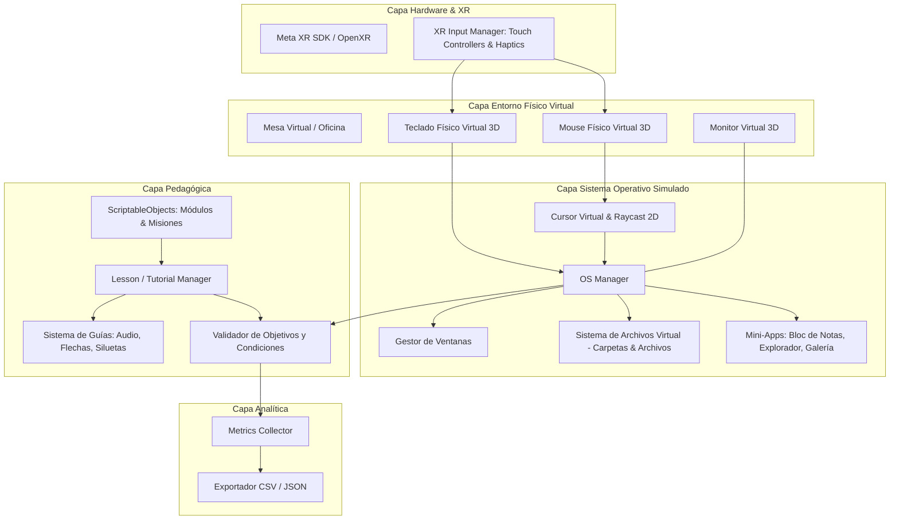

# Plan de Arquitectura y Especificación Técnica: DeskVR

Entorno de Realidad Virtual para el aprendizaje intuitivo del uso básico de una computadora, dirigido a personas con baja alfabetización digital.

---

## 🛠️ Stack Tecnológico

| Componente | Tecnología / Herramienta | Justificación |
| :--- | :--- | :--- |
| **Motor de Desarrollo** | **Unity (C#)** — Versión 2022.3 LTS o Unity 6 LTS | Estándar de la industria, soporte maduro para standalone VR y alta optimización. |
| **Render Pipeline** | **Universal Render Pipeline (URP)** | Renderizado eficiente de alto rendimiento (72/90/120 Hz) para Meta Quest. |
| **Plataforma Objetivo** | **Meta Quest Standalone** (Quest 2 / Quest 3 / Quest 3S) | Ejecución directa en el visor sin cables ni dependencia de PC externa. |
| **Framework de XR** | **OpenXR + Meta XR Core SDK / XR Interaction Toolkit (XRI)** | Detección de controladores Touch, retroalimentación háptica y compatibilidad futura con Hand Tracking. |
| **Entorno y UI Simulada** | **Unity World-Space Canvas / Render Texture** | Renderizado nítido de la pantalla virtual, interactuable con puntero 3D y eventos nativos de C#. |
| **Sistema de Animación UI** | **DOTween / LeanTween** | Micro-animaciones fluidas para guías visuales, ventanas y efectos de resaltado (*glow/pulsing*). |
| **Almacenamiento de Métricas** | **Persistencia Local (CSV / JSON)** (`Application.persistentDataPath`) | Registro offline de tiempos, errores, pistas y nivel de autonomía para evaluación académica. |

---

## 🏛️ Arquitectura del Software (Patrón Modular en Capas)



---

## 🧩 Módulos Principales de DeskVR

### 1. Interacción Física y Periféricos (`DeskVR.PhysicalInteraction`)
* **Mouse Virtual (`VirtualMouseController.cs`):** 
  * Detección de agarre con el controlador VR.
  * Mapeo del movimiento físico sobre la mesa al plano 2D de la pantalla virtual.
  * Botones físicos virtuales (clic izquierdo, clic derecho, rueda de desplazamiento).
  * Retroalimentación háptica (pulsos de vibración diferenciados para clic simple, doble clic y arrastre).
* **Teclado Virtual (`VirtualKeyboardController.cs`):**
  * Teclas 3D presionables con detección de colisión/proximidad.
  * Mapeo de pulsaciones hacia el campo de texto activo en la pantalla virtual.
  * Iluminación dinámica de teclas solicitadas por el tutorial (ej. tecla *Enter*, *Espacio*, *Borrar*).

### 2. Sistema Operativo Simulado (`DeskVR.SimulatedOS`)
* **Gestor de Escritorio y Pantalla (`DesktopManager.cs`):** 
  * Fondo de escritorio, barra de tareas, menú de inicio simplificado, área de notificaciones e iconos.
* **Sistema de Ventanas (`VirtualWindow.cs`):**
  * Operaciones: Abrir, cerrar ($X$), minimizar, maximizar y arrastrar por la barra de título.
  * Profundidad de capas (foco de ventana activa al hacer clic).
* **Explorador y Sistema de Archivos (`VirtualFileSystem.cs`):**
  * Jerarquía simulada en memoria (creación de carpetas, renombrado, mover archivos mediante *drag & drop*, guardar documentos).
* **Aplicaciones de Práctica (`SimulatedApps/`):**
  * *TextEditorApp*: Escritura básica, edición y guardado de archivos de texto.
  * *FileExplorerApp*: Visualización y organización de carpetas y archivos.
  * *ImageViewerApp*: Apertura de imágenes para práctica de doble clic.

### 3. Motor Pedagógico y Lecciones (`DeskVR.Curriculum`)
* **Estructura basada en `ScriptableObjects`:**
  * `LessonModuleSO`: Define un bloque de aprendizaje (ej. *Módulo 1: Control del Mouse*).
  * `LessonStepSO`: Define un paso concreto (ej. *Hacer doble clic en la carpeta "Documentos"*).
  * `ValidationTriggerSO`: Condición que marca el paso como completado (ej. evento `OnFolderOpened`).
* **Sistema de Guías Sensoriales (`GuidanceSystem.cs`):**
  * **Visual:** Punteros luminosos, siluetas guía (*ghost hints*), flechas 3D animadas, resaltado de elementos interactivos (*pulse glow*).
  * **Auditivo:** Explicaciones por voz claras, efectos sonoros de éxito (*chime*) y error no punitivo.
  * **Texto:** Instrucciones legibles de alto contraste con tipografía clara y grande.

### 4. Recolección de Métricas para Investigación (`DeskVR.Analytics`)
* **Registro de datos por sesión (`MetricsManager.cs`):**
  * `SessionID`, `SubjectID`, `Timestamp`.
  * Tiempo por módulo / lección (segundos).
  * Conteo de errores y clics fuera de objetivo (*misclicks*).
  * Pistas requeridas / activadas por tiempo de inactividad.
  * Tasa de completitud y nivel de autonomía alcanzado.
* **Exportador:** Generación automática de reportes en `.csv` y `.json` accesibles vía almacenamiento del visor (`/sdcard/Android/data/...`).

---

## 📂 Estructura de Carpetas para Unity

```text
DeskVR/
├── Assets/
│   ├── _Project/
│   │   ├── Animations/         # Animaciones de UI, manos, periféricos
│   │   ├── Audio/              # Efectos de sonido y locuciones explicativas
│   │   ├── Materials/          # Materiales URP optimizados para Quest
│   │   ├── Models/             # Modelos 3D (escritorio, monitor, mouse, teclado, oficina)
│   │   ├── Prefabs/
│   │   │   ├── Environment/    # Prefabs de la sala y mesa
│   │   │   ├── OS/             # Prefabs de ventanas, iconos, diálogos
│   │   │   ├── Peripherals/    # Prefabs del mouse y teclado interactivos
│   │   │   └── UI/             # Prefabs de paneles tutoriales y retroalimentación
│   │   ├── ScriptableObjects/
│   │   │   ├── Lessons/        # Definiciones de módulos y pasos de aprendizaje
│   │   │   └── Profiles/       # Configuraciones de dificultad y accesibilidad
│   │   ├── Scripts/
│   │   │   ├── Analytics/      # Métricas, logging y exportador CSV
│   │   │   ├── Core/           # GameManager, EventManager, AppState
│   │   │   ├── Curriculum/     # LessonManager, StepValidator, GuidanceManager
│   │   │   ├── OS/             # Desktop, Windows, FileSystem, SimulatedApps
│   │   │   ├── Peripherals/    # VirtualMouse, VirtualKeyboard, HapticFeedback
│   │   │   └── XR/             # XR Rig Setup, ControllerBindings, HandTrackingAdapter
│   │   ├── Shaders/            # Shaders ligeros (resaltados, glows)
│   │   └── Textures/           # Iconos de SO, fondos de pantalla, texturas
│   ├── Settings/               # Configuración URP, OpenXR y TextMeshPro
│   └── XR/                     # Presets de OpenXR y Meta XR
└── ProjectSettings/
```
